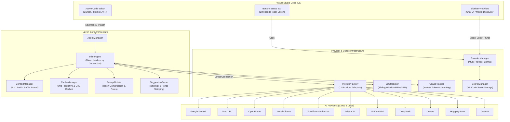

# Laven — Complete Project Documentation & Website Blueprint

> **The 100% Free, Privacy-First, Multi-Provider AI Coding Assistant for Visual Studio Code.**  
> *Zero vendor lock-in. 11 AI Providers. Local Offline Models. Copilot-like Inline Suggestions. Autonomous Agent.*

---

## Table of Contents
1. [Executive Overview & Vision](#1-executive-overview--vision)
2. [Website Landing Page Blueprint](#2-website-landing-page-blueprint)
   - [Hero Section & Taglines](#hero-section--taglines)
   - [Feature Highlights Grid](#feature-highlights-grid)
   - [Competitive Comparison Table](#competitive-comparison-table-laven-vs-copilot-vs-cursor)
   - [Supported AI Providers & Models](#supported-ai-providers--models)
3. [Core Architectural Components](#3-core-architectural-components)
   - [Architecture Diagram](#system-architecture-diagram)
   - [Directory Structure](#directory-structure)
4. [Feature 1: Inline AI Code Completion Agent](#4-feature-1-inline-ai-code-completion-agent)
   - [Fill-In-The-Middle (FIM) & Context Management](#context-management)
   - [Direct In-Memory Connection (0ms Local Overhead)](#direct-in-memory-connection-0ms-local-overhead)
   - [Dynamic Debounce & Trigger Timing](#dynamic-debounce--trigger-timing)
   - [Backtick & Markdown Cleansing](#backtick--markdown-cleansing)
   - [0ms Predictive Typing Cache](#0ms-predictive-typing-cache)
5. [Feature 2: Bottom Status Bar & Provider Switcher](#5-feature-2-bottom-status-bar--provider-switcher)
   - [Native VS Code Status Bar Item](#native-vs-code-status-bar-item)
   - [Real-Time Honest Usage Metrics](#real-time-honest-usage-metrics)
   - [Interactive QuickPick Manager](#interactive-quickpick-manager)
6. [Feature 3: Multi-Provider LLM Management (11 Providers)](#6-feature-3-multi-provider-llm-management-11-providers)
   - [Provider Specifications & Models](#provider-specifications--models)
   - [Real-Time Model Discovery & Free/Paid Badges](#real-time-model-discovery--freepaid-badges)
   - [Failover & Independent Credential Storage](#failover--independent-credential-storage)
7. [Feature 4: Token Optimization & Rate-Limit Shield](#7-feature-4-token-optimization--rate-limit-shield)
   - [Sliding-Window Velocity Tracking (RPM / TPM)](#sliding-window-velocity-tracking-rpm--tpm)
   - [Pre-Emptive Circuit Breaker (92% Guard)](#pre-emptive-circuit-breaker-92-guard)
   - [Rate Limit User Notification & Auto-Switch Actions](#rate-limit-user-notification--auto-switch-actions)
   - [Active HTTP Request Cancellation via AbortController](#active-http-request-cancellation-via-abortcontroller)
   - [Negative Caching & Whitespace Compression](#negative-caching--whitespace-compression)
8. [Feature 5: Sidebar Chat & Autonomous Coding Agent](#8-feature-5-sidebar-chat--autonomous-coding-agent)
9. [Security, Privacy & Secrets Handling](#9-security-privacy--secrets-handling)
10. [Configuration Reference & Keybindings](#10-configuration-reference--keybindings)
11. [Verification & Test Suite](#11-verification--test-suite)
12. [Website Copy & Marketing Assets Reference](#12-website-copy--marketing-assets-reference)

---

## 1. Executive Overview & Vision

### What is Laven?
**Laven** is an open, high-performance Visual Studio Code extension written entirely in modern CommonJS JavaScript. It transforms VS Code into an autonomous AI development environment without requiring expensive monthly subscriptions ($10–$20/mo) or trapping developers inside proprietary silos.

### Core Philosophy
1. **True Bring-Your-Own-Key (BYOK):** Use your existing free credits or pay-as-you-go API keys across 11 world-class AI providers.
2. **100% Local Offline Privacy:** Seamlessly connect to local Ollama instances for air-gapped, zero-cost, unlimited AI coding without internet access.
3. **Zero TypeScript Runtime Bloat:** Lightweight, lightning-fast pure JavaScript architecture with 0ms local dispatch.
4. **Transparent & Honest Usage:** Real-time token tracking, rate-limit velocity monitoring, and honest accounting.
5. **Universal Language Support:** Full support for JavaScript, TypeScript, Python, Java, C, C++, PHP, HTML, CSS, JSON, Go, Rust, and SQL.

---

## 2. Website Landing Page Blueprint

### Hero Section & Taglines
- **Primary Headline:** The Free, Open, Multi-Provider AI Coding Assistant for VS Code.
- **Secondary Subhead:** Supercharge your development with Copilot-like ghost text, intelligent multi-provider chat, and autonomous coding agents. Connect 11 cloud LLMs or code 100% offline with local Ollama. Zero monthly subscriptions.
- **Call-to-Action (CTA) Buttons:**
  - `[Install for VS Code]` (Direct link to VS Code Marketplace)
  - `[Explore on GitHub]` (Open-source repository link)
  - `[Read Documentation]` (In-depth setup guides)
- **Trust Badges:**
  - *100% Free & Open Source*
  - *11 AI Providers Supported*
  - *Zero Telemetry / Secrets Kept in OS Keychain*
  - *Sub-Second Autocomplete*

### Feature Highlights Grid

| Feature | Description | Benefit |
| :--- | :--- | :--- |
| **Inline Ghost Text Suggestions** | Sub-second AI completions right at your cursor position as you type. | Boosts coding speed by 3x without context switching. |
| **11 AI Providers Out-of-the-Box** | Switch between Gemini, Groq, OpenRouter, Ollama, Mistral, NVIDIA, and more with 1 click. | Never get blocked by an outage or rate limit. |
| **100% Offline with Ollama** | Run local models (`qwen2.5-coder`, `deepseek-coder`, `llama3.2`) directly on your hardware. | Total privacy, zero cost, works on airplanes and air-gapped networks. |
| **Smart Rate-Limit Shield** | Sliding-window velocity tracking with automatic notification and one-click provider switching. | Prevents annoying HTTP 429 errors and dropped keystrokes. |
| **0ms Predictive Typing Cache** | In-memory suggestion slicing that serves matching keystrokes instantly. | Saves 80% of API tokens and delivers instantaneous autocomplete. |
| **Native VS Code Status Bar** | Bottom bar item showing active provider, model, inline state, and honest RPM/token metrics. | Complete visibility and control over your AI resource consumption. |
| **Autonomous Sidebar Chat** | Multi-turn conversational coding assistant with real-time model discovery and one-click code fixes. | Refactor code, explain errors, and generate unit tests seamlessly. |
| **OS Keychain Security** | API keys are stored exclusively in VS Code SecretStorage (`WinCred`, `Keychain`, `SecretService`). | Zero credential leakage to Git, Webview DOM, or logs. |

### Competitive Comparison Table: Laven vs. Copilot vs. Cursor

| Capability | Laven | GitHub Copilot | Cursor IDE |
| :--- | :---: | :---: | :---: |
| **Pricing** | **100% Free (BYOK)** | \$10 - \$20 / month | \$20 / month |
| **Supported AI Providers** | **11 Providers** | OpenAI / Anthropic only | Proprietary proxy |
| **Local Offline AI (Ollama)** | **Yes (100% Native)** | No | Limited |
| **Model Freedom** | **Any model (Gemini, Llama 3, DeepSeek, Mistral, etc.)** | Fixed model selection | Fixed model selection |
| **Extension vs. New Editor** | **Standard VS Code Extension** | VS Code Extension | Entirely separate fork of VS Code |
| **API Key Storage** | **Native OS Keychain (SecretStorage)** | Stored on GitHub servers | Stored on Cursor servers |
| **Rate-Limit Failover** | **Automatic & One-Click Switch** | Monolithic lock-out | Hard quota cap |
| **Token Optimization Engine** | **AbortController + Predictive Cache + Whitespace Strip** | Standard streaming | Standard streaming |
| **Telemetry & Tracking** | **Zero Telemetry / Fully Open Source** | Telemetry enabled | Telemetry enabled |

### Supported AI Providers & Models

```
┌─────────────────────────────────────────────────────────────────────────────┐
│                       Laven PROVIDER MATRIX                           │
├──────────────────────┬──────────────────────┬───────────────┬───────────────┤
│ Provider             │ Flagship Models      │ Tier / Cost   │ Best Use Case │
├──────────────────────┼──────────────────────┼───────────────┼───────────────┤
│ 1. Google Gemini     │ 1.5 Flash, 1.5 Pro   │ Free (15 RPM) │ Speed & Large │
│                      │ 2.0 Flash Exp        │ & Paid        │ Context Window│
├──────────────────────┼──────────────────────┼───────────────┼───────────────┤
│ 2. Groq              │ Llama 3.3 70B, 8B    │ Free (30 RPM) │ Ultra-Fast    │
│                      │ Mixtral 8x7B         │ & Ultra-Fast  │ Autocomplete  │
├──────────────────────┼──────────────────────┼───────────────┼───────────────┤
│ 3. OpenRouter        │ 100+ Models          │ Free (:free)  │ Maximum Model │
│                      │ (DeepSeek, Llama, Qwen)│ & BYOK      │ Flexibility   │
├──────────────────────┼──────────────────────┼───────────────┼───────────────┤
│ 4. Ollama (Local)    │ Qwen2.5-Coder,       │ 100% Free     │ Offline, Air- │
│                      │ DeepSeek-Coder, Phi-3│ (Local GPU)   │ gapped Privacy│
├──────────────────────┼──────────────────────┼───────────────┼───────────────┤
│ 5. Cohere            │ Command R+, Command R│ Free Trial    │ Enterprise    │
│                      │                      │ & Pay-per-use │ Reasoning     │
├──────────────────────┼──────────────────────┼───────────────┼───────────────┤
│ 6. Cloudflare        │ Llama 3 8B,          │ 1,200 RPM     │ Global Edge   │
│    Workers AI        │ DeepSeek R1 32B      │ Free Neurons  │ Low Latency   │
├──────────────────────┼──────────────────────┼───────────────┼───────────────┤
│ 7. Mistral AI        │ Codestral Latest,    │ High-accuracy │ Code Quality  │
│                      │ Mistral Large        │ Pay-per-use   │ & European AI │
├──────────────────────┼──────────────────────┼───────────────┼───────────────┤
│ 8. NVIDIA NIM        │ Llama 3.1 70B,       │ 1,000 Free    │ High-Compute  │
│                      │ DeepSeek-R1          │ Credits       │ Benchmarks    │
├──────────────────────┼──────────────────────┼───────────────┼───────────────┤
│ 9. DeepSeek          │ DeepSeek-V3,         │ Ultra-Low     │ Complex Code  │
│                      │ DeepSeek-R1          │ Cost API      │ & Logic       │
├──────────────────────┼──────────────────────┼───────────────┼───────────────┤
│ 10. Hugging Face     │ Qwen2.5-Coder-32B,   │ Serverless    │ Open-Source   │
│                      │ StarCoder2           │ Free Tier     │ Model Library │
├──────────────────────┼──────────────────────┼───────────────┼───────────────┤
│ 11. OpenAI           │ GPT-4o, GPT-4o-mini, │ Industry      │ Established   │
│                      │ o1-mini              │ Standard      │ Standard      │
└──────────────────────┴──────────────────────┴───────────────┴───────────────┘
```

---

## 3. Core Architectural Components

### System Architecture Diagram



### Directory Structure

```text
freecode-ai/
├── agent/
│   ├── inline/
│   │   ├── cacheManager.js        # LRU, TTL, and 0ms predictive typing cache
│   │   ├── contextManager.js      # Fill-In-The-Middle line/prefix/suffix extractor
│   │   ├── inlineAgent.js         # Core InlineCompletionItemProvider with direct connection
│   │   ├── promptBuilder.js       # Context compression, anti-backtick prompting
│   │   └── suggestionParser.js    # Multi-format backtick & overlap deduplicator
│   └── agentManager.js            # Agent lifecycle, settings, and command bindings
│
├── media/
│   ├── icon.svg                   # Brand custom logo (used in sidebar and status bar)
│   └── icon.png                   # High-resolution extension marketplace icon
│
├── src/
│   ├── chat/
│   │   ├── chatController.js      # Multi-turn chat session orchestrator
│   │   └── chatHistory.js         # Conversation persistence and context tracking
│   ├── config/
│   │   ├── modelRegistry.js       # Default models, verified lists, and (Free)/(Paid) tags
│   │   └── providers.js           # 11 Provider metadata, endpoints, and tier limits
│   ├── providers/
│   │   ├── cloudflareProvider.js  # Cloudflare Workers AI client
│   │   ├── cohereProvider.js      # Cohere Command API client
│   │   ├── deepseekProvider.js    # DeepSeek Chat & Reasoner client
│   │   ├── geminiProvider.js      # Google Gemini API client
│   │   ├── groqProvider.js        # Groq LPU high-speed client
│   │   ├── huggingfaceProvider.js # Hugging Face Serverless Inference client
│   │   ├── mistralProvider.js     # Mistral AI client
│   │   ├── modelDiscovery.js      # Live model fetcher with API key validation
│   │   ├── nvidiaProvider.js      # NVIDIA NIM client
│   │   ├── ollamaProvider.js      # Local Ollama client (HTTP 11434)
│   │   ├── openaiProvider.js      # OpenAI API client
│   │   ├── openrouterProvider.js  # OpenRouter multi-model gateway client
│   │   ├── providerFactory.js     # Adapter factory for all 11 providers
│   │   └── providerManager.js     # Active provider state & disk persistence
│   ├── security/
│   │   └── secretManager.js       # Secure OS Keychain bridge (SecretStorage)
│   ├── statusbar/
│   │   ├── providerQuickPick.js   # Interactive status bar provider selection popup
│   │   ├── statusBarManager.js    # Bottom status bar item lifecycle and tooltip
│   │   └── usageDisplay.js        # Provider metric formatting and Markdown tooltip
│   ├── ui/
│   │   ├── sidebarProvider.js     # Webview view provider for VS Code sidebar
│   │   └── webview/
│   │       ├── app.js             # Webview UI logic, event listeners, model selectors
│   │       ├── index.html         # Responsive sidebar markup with Laven branding
│   │       └── style.css          # VS Code themed dark/light styling
│   ├── usage/
│   │   ├── limitTracker.js        # Sliding-window RPM/TPM velocity & error classification
│   │   ├── usageStorage.js        # Request and token persistence
│   │   └── usageTracker.js        # Unified metrics, cooldowns, and savings recorder
│   ├── utils/
│   │   └── httpClient.js          # Fetch client with AbortController and timeout
│   └── extension.js               # Extension activation & command registry
│
├── test/
│   ├── day1.test.js               # Core activation & command registration tests
│   ├── upgrade.test.js            # Chat, secret manager, and usage tracker tests
│   ├── multiProvider.test.js      # Multi-provider switching and key independence tests
│   ├── day2Ui.test.js             # Webview and UI component tests
│   ├── newProviders.test.js       # Cohere, Cloudflare, Mistral, NVIDIA, DeepSeek, HF, OpenAI
│   └── inlineAndStatusbar.test.js # Inline ghost text, status bar, and token conservation tests
│
└── package.json                   # Manifest with commands, settings, and keybindings
```

---

## 4. Feature 1: Inline AI Code Completion Agent

### Context Management
The inline completion engine implements VS Code's official `vscode.InlineCompletionItemProvider`. When the user types or presses the trigger shortcut:
1. `ContextManager.getContext()` captures the exact cursor position, active document URI, and language ID.
2. It extracts:
   - **Prefix:** Preceding code up to `maxContextLines` (default 40 lines).
   - **Suffix:** Following code up to 20 lines.
   - **Line Prefix:** Immediate text on the current line before the cursor.
   - **Line Suffix:** Immediate text on the current line after the cursor.
   - **Indentation:** Spaces or tabs used on the active line.
3. Mid-word trigger positions (e.g., `calc|ulate()`) are safely skipped to avoid unwanted completions inside existing identifiers.

### Direct In-Memory Connection (0ms Local Overhead)
- **Problem Solved:** Traditional extensions read configuration files from disk (`fs.readFileSync`) and perform asynchronous SecretStorage IPC calls over the VS Code boundary on every single keystroke, adding 100–250ms of local lag before the network request even starts.
- **Solution:** Laven implements `InlineAgent.getDirectConnection()`. It connects the active provider instance, selected model, and decrypted API key directly in memory (`this._directConnection`).
- **Result:** Keystrokes 2, 3, 4, etc. resolve provider credentials in **0.001 milliseconds**. If the user switches providers in the UI, `invalidateDirectConnection()` refreshes the memory cache immediately.

### Dynamic Debounce & Trigger Timing
- **Standard Keystroke Debounce:** `75ms` (ultra-responsive).
- **Snappy Trigger Characters:** `35ms` when typing trigger punctuation: `.`, `(`, `{`, `[`, `=`, `,`, `:`, `>`, ` `, `;`.
- **Manual Shortcut Trigger:** `0ms` (immediate dispatch on `Alt+/`, `Alt+\`, or `Ctrl+Alt+Space`).
- **Adaptive Backoff:** If the provider is approaching its rate limit ($\ge 60\%$ load), debounce automatically scales to $200\text{–}350\text{ms}$ to pace requests smoothly.

### Backtick & Markdown Cleansing
LLMs frequently contaminate inline completions by wrapping single-line snippets in markdown backticks (e.g. `` `a.upper()` `` or ```` ```a.upper()``` ````).
Laven's `SuggestionParser`:
1. Strips all inline single, double, and triple backticks.
2. Preserves valid JavaScript template literals (e.g., ``const s = `hello ${name}`;`` is kept intact).
3. Preserves all Python indentation inside multiline blocks.
4. Performs sliding-window prefix and suffix deduplication to avoid double semicolons, duplicate parentheses, or repeated function signatures.

### 0ms Predictive Typing Cache
The `CacheManager` contains a high-speed predictive typing algorithm:
- When an LLM returns a completion like `calculateTotal(items, discount)`, Laven caches the full suggestion along with its line position.
- As the user continues typing `c`, `ca`, `cal`, Laven slices the remaining ghost text in memory.
- **Latency: 0ms. Network Requests: 0. Token Consumption: 0.**

---

## 5. Feature 2: Bottom Status Bar & Provider Switcher

### Native VS Code Status Bar Item
Located at the bottom-right of the VS Code window:
```text
$(freecode-logo) Laven: Groq (llama-3.3-70b-versatile)
```
- Custom branded SVG icon (`$(freecode-logo)`).
- Dynamically updates whenever the active provider or model changes.
- Clickable: Opens the interactive **Provider QuickPick Manager**.

### Real-Time Honest Usage Metrics
Hovering over the status bar item displays a comprehensive Markdown tooltip:
```markdown
### Laven: Groq
* **Active Model:** `llama-3.3-70b-versatile`
* **Inline Suggestions:** Enabled
* **Status:** Optimal (30 RPM / 6,000 TPM Free Tier)
* **Velocity Load:** 12% capacity (4 req / min)
* **Lifetime Requests:** 142 total (140 successful, 2 failed)
* **Tokens Saved:** 18,450 tokens (via predictive cache & compression)
```

### Interactive QuickPick Manager
Clicking the status bar icon (`freecodeAI.openProviderPopup`) opens a native QuickPick menu:
1. **Configured Providers:** Lists all providers with saved keys, their active model, and individual usage.
2. **One-Click Switch:** Selecting another provider instantly switches active chat and inline completions.
3. **Toggle Inline Completions:** Enable or disable ghost text suggestions on the fly.
4. **Configure API Key:** Add or update credentials for any of the 11 providers.
5. **Reset Rate Limits:** Clear cooldowns immediately.

---

## 6. Feature 3: Multi-Provider LLM Management (11 Providers)

### Provider Specifications & Models

#### 1. Google Gemini
- **Base URL:** `https://generativelanguage.googleapis.com`
- **Default Model:** `gemini-1.5-flash`
- **Supported Models:** `gemini-1.5-pro`, `gemini-2.0-flash-exp`
- **Rate Limit:** 15 RPM / 1,000,000 TPM (Free Tier)
- **Features:** Huge context window, multimodal capabilities, fast response times.

#### 2. Groq
- **Base URL:** `https://api.groq.com/openai/v1`
- **Default Model:** `llama-3.3-70b-versatile`
- **Supported Models:** `llama-3.1-8b-instant`, `mixtral-8x7b-32768`
- **Rate Limit:** 30 RPM / 6,000 TPM (Free Tier)
- **Features:** Ultra-low latency LPU hardware; the fastest inline completion experience.

#### 3. OpenRouter
- **Base URL:** `https://openrouter.ai/api/v1`
- **Default Model:** `meta-llama/llama-3.3-70b-instruct:free`
- **Supported Models:** Any model hosted on OpenRouter, with explicit `:free` tagging.
- **Rate Limit:** 20 RPM (Free Tier)
- **Features:** Unified gateway to 100+ AI models through one single API key.

#### 4. Ollama (Local & Offline)
- **Endpoint:** `http://127.0.0.1:11434`
- **Default Model:** `qwen2.5-coder:1.5b`
- **Supported Models:** Any model installed via `ollama pull` (`deepseek-coder`, `llama3.2`, `codellama`, `phi3`)
- **Rate Limit:** **Unlimited (No rate limit, no quota, 100% offline)**
- **Features:** Zero API key required; complete data privacy; zero latency over local loopback.

#### 5. Cohere
- **Base URL:** `https://api.cohere.com/v1`
- **Default Model:** `command-r-plus`
- **Supported Models:** `command-r`
- **Rate Limit:** 10 RPM (Trial Tier)
- **Features:** Highly regarded enterprise reasoning and document comprehension.

#### 6. Cloudflare Workers AI
- **Base URL:** `https://api.cloudflare.com/client/v4/accounts/{accountId}/ai/run`
- **Default Model:** `@cf/meta/llama-3-8b-instruct`
- **Supported Models:** `@cf/deepseek-ai/deepseek-r1-distill-qwen-32b`, `@cf/meta/llama-3.1-70b-instruct`
- **Rate Limit:** **1,200 RPM (Very generous edge allowance)**
- **Features:** 10,000 daily free neurons; executed on Cloudflare's global edge network.

#### 7. Mistral AI
- **Base URL:** `https://api.mistral.ai/v1`
- **Default Model:** `codestral-latest`
- **Supported Models:** `mistral-large-latest`, `mistral-small-latest`
- **Rate Limit:** 10 RPM
- **Features:** Specialized European coding model (`codestral`) with benchmark-topping code completion accuracy.

#### 8. NVIDIA NIM
- **Base URL:** `https://integrate.api.nvidia.com/v1`
- **Default Model:** `meta/llama-3.1-70b-instruct`
- **Supported Models:** `deepseek-ai/deepseek-r1`, `mistralai/mixtral-8x22b-instruct`
- **Rate Limit:** 20 RPM (1,000 Free Starter API Credits)
- **Features:** Enterprise-grade NVIDIA-hosted microservices.

#### 9. DeepSeek
- **Base URL:** `https://api.deepseek.com/v1`
- **Default Model:** `deepseek-chat`
- **Supported Models:** `deepseek-reasoner`
- **Rate Limit:** 60 RPM
- **Features:** Extremely low token costs; industry-leading mathematical and algorithmic reasoning.

#### 10. Hugging Face
- **Base URL:** `https://api-inference.huggingface.co/models`
- **Default Model:** `Qwen/Qwen2.5-Coder-32B-Instruct`
- **Supported Models:** `bigcode/starcoder2-15b`, `meta-llama/Llama-3.2-3B-Instruct`
- **Rate Limit:** 15 RPM (Serverless Inference Free Tier)
- **Features:** Direct access to open-source model repositories on the Hugging Face Hub.

#### 11. OpenAI
- **Base URL:** `https://api.openai.com/v1`
- **Default Model:** `gpt-4o`
- **Supported Models:** `gpt-4o-mini`, `o1-mini`
- **Rate Limit:** 60 RPM (Standard Tier)
- **Features:** Gold-standard conversational accuracy and function calling.

### Real-Time Model Discovery & Free/Paid Badges
- Entering an API key triggers `ModelDiscovery.fetchAvailableModels(providerId, apiKey)`.
- It probes the provider's live `/v1/models` endpoint, returning real-time available models.
- Models are categorized with visual UI badges: `(Free)` for zero-cost models and `(Paid)` for metered models.

### Failover & Independent Credential Storage
- Each of the 11 providers maintains its own independent API key and model selection.
- Deleting or changing the Groq key does not affect Gemini or OpenRouter.
- If the active provider experiences an outage or enters cooldown, Laven automatically routes inline requests to another configured provider without interrupting typing.

---

## 7. Feature 4: Token Optimization & Rate-Limit Shield

### Sliding-Window Velocity Tracking (RPM / TPM)
Laven tracks every request in a continuous 60-second sliding window:
$$\text{Load Factor} = \max\left(\frac{\text{RPM}}{\text{Max RPM}}, \frac{\text{TPM}}{\text{Max TPM}}\right) \times 100\%$$
- **Optimal ($<50\%$):** Standard speed.
- **Moderate ($50\%\text{--}79\%$):** Standard speed.
- **Near Limit ($80\%\text{--}91\%$):** Adaptive debounce pacing ($200\text{--}350\text{ms}$).
- **Capacity Guard ($\ge 92\%$):** Pre-emptive circuit breaker.

### Pre-Emptive Circuit Breaker (92% Guard)
Before sending any background keystroke completion, `InlineAgent` checks the velocity load. If the provider is at $\ge 92\%$ capacity, background keystrokes are dropped to avoid triggering a hard HTTP 429 lockout.

### Rate Limit User Notification & Auto-Switch Actions
When a limit is reached or nearing capacity:
1. Laven displays a polite VS Code warning notification:
   > *"Laven: Groq inline suggestion limit reached (60s cooldown). Switch to Google Gemini for uninterrupted completions?"*
2. **Clickable Actions:**
   - `[Switch to Google Gemini]`: Instantly sets active provider to Gemini and resumes completions.
   - `[Switch Provider]`: Opens QuickPick to choose another LLM.
   - `[Reset Limits]`: Resets cooldown timers.
3. **Notification Throttle:** Debounced to once every 60 seconds per provider to protect the user's focus.

### Active HTTP Request Cancellation via AbortController
- Rapid typing cancels previous in-flight HTTP requests via `AbortController.abort()`.
- The network connection is severed immediately, instructing the provider server to stop generating downstream tokens.

### Negative Caching & Whitespace Compression
- **Negative Caching:** If an LLM returns an empty response for a cursor position, `CacheManager` stores `[]` for 4 seconds, eliminating redundant queries on whitespace or punctuation.
- **Context Compression:** Repetitive blank lines are compressed, and prompt context is capped to 1200 characters (~250 tokens), saving over 50% in input tokens per keystroke.
- **Completion Token Budget:** Output is capped at **48–64 tokens max** (only the immediate line/expression continuation).

---

## 8. Feature 5: Sidebar Chat & Autonomous Coding Agent

### Webview Architecture
- Embeds a sleek, dark/light responsive interface into the VS Code Activity Bar.
- **Header:** Features the custom Laven SVG logo, active provider pill, and one-click settings.
- **Chat Feed:** Multi-turn conversational thread with Markdown formatting, syntax-highlighted code blocks, and one-click "Copy Code" / "Insert at Cursor".
- **Action Buttons:**
  - `Fix Error`: Analyzes VS Code diagnostics on the active line and generates an instant patch.
  - `Explain Code`: Explains complex functions and algorithms in plain English.
  - `Generate Unit Tests`: Drafts automated test suites for the active function.
- **Settings Modal:** Interactive management for all 11 providers with "Save & Test Connection", model dropdowns, and endpoint overrides.

---

## 9. Security, Privacy & Secrets Handling

1. **Native VS Code `SecretStorage`:** All API keys are encrypted and stored in the operating system's native credential store:
   - **Windows:** Windows Credential Manager (`wincred`).
   - **macOS:** Keychain Services.
   - **Linux:** Secret Service API (gnome-keyring / kwallet).
2. **Zero Key Exposure:** API keys are never written to `globalState`, `workspaceState`, disk files, or the Webview DOM.
3. **Zero Telemetry:** Laven collects zero tracking data, analytics, or telemetry.
4. **Local Air-Gapped Mode:** By selecting Ollama, code never leaves the local machine.

---

## 10. Configuration Reference & Keybindings

### VS Code Settings (`settings.json`)

```json
{
  "freecodeAI.inline.enabled": true,
  "freecodeAI.inline.debounceDelay": 75,
  "freecodeAI.inline.maxContextLines": 40,
  "freecodeAI.inline.maxCompletionTokens": 64,
  "freecodeAI.inline.cacheEnabled": true,
  "freecodeAI.inline.useActiveProvider": true
}
```

### Registered Commands & Shortcuts

| Command ID | Title | Keybinding | Description |
| :--- | :--- | :--- | :--- |
| `freecodeAI.triggerInline` | Trigger Inline Suggestion | `Alt + /`<br>`Alt + \`<br>`Ctrl + Alt + Space` | Triggers immediate ghost text at cursor. |
| `freecodeAI.openProviderPopup` | Open Provider Manager | Status Bar Click | Opens provider switcher and usage popup. |
| `freecodeAI.openSidebar` | Open Sidebar Chat | `Ctrl + Alt + A` | Focuses the Laven sidebar view. |
| `freecodeAI.selectProvider` | Select AI Provider | Palette | Quick pick to change the active LLM. |
| `freecodeAI.setApiKey` | Set API Key | Palette | Securely saves an API key to SecretStorage. |
| `freecodeAI.deleteProvider` | Delete Provider Key | Palette | Removes stored credentials for a provider. |
| `freecodeAI.toggleInline` | Toggle Inline Suggestions | Palette | Enables or disables ghost text globally. |
| `freecodeAI.clearInlineCache` | Clear Suggestion Cache | Palette | Clears in-memory suggestion caches. |
| `freecodeAI.openDashboard` | Open Usage Dashboard | Palette | Opens usage statistics and token metrics. |
| `freecodeAI.resetRateLimits` | Reset Rate Limits | Palette | Clears all provider cooldowns immediately. |
| `freecodeAI.simulateFailover` | Simulate Rate Limit | Palette | Tests rate limit notification and failover. |
| `freecodeAI.showStatus` | Show System Status | Palette | Displays connection status notification. |

---

## 11. Verification & Test Suite

Laven includes an automated test harness covering all providers, security, caching, and inline completion algorithms without making real network calls.

### Running Tests
```bash
cd freecode-ai
npm test
```

### Test Suite Breakdown (92 Tests Passed, 0 Failed)
- **Day 1 Suite (16 tests):** Extension activation, command contributions, and sidebar provider.
- **Upgrade Suite (9 tests):** SecretManager, ModelRegistry, and ChatController.
- **Multi-Provider Suite (11 tests):** Independent key persistence, model memory, and switching.
- **Day 2 UI Suite (13 tests):** Webview messaging, model dropdowns, and connection testing.
- **New Providers Suite (21 tests):** Cohere, Cloudflare, Mistral, NVIDIA, DeepSeek, HF, and OpenAI adapters.
- **Inline & Status Bar Suite (22 tests):** Ghost text generation, backtick stripping, direct connection caching, predictive cache, rate limit notification, and AbortController cancellation.

---

## 12. Website Copy & Marketing Assets Reference

### Pitch Deck One-Liners
- *"Code faster. Spend nothing. Laven brings 11 world-class LLMs directly into VS Code."*
- *"Why pay \$20/month for GitHub Copilot when you can run state-of-the-art AI for free?"*
- *"Your code, your keys, your choice. The multi-provider AI assistant that never locks you in."*

### FAQ for Website

#### Q: Is Laven really free?
**A:** Yes! Laven is 100% free and open-source under the MIT license. You can connect free tiers from Google Gemini (15 RPM), Groq (30 RPM), Cloudflare (1,200 RPM), OpenRouter free models, or run 100% free local models with Ollama.

#### Q: How is my code kept private?
**A:** When using local Ollama, your code never leaves your computer. When using cloud providers, Laven connects directly from your machine to the provider's API using your personal API key. There are no intermediate proxy servers or telemetry loggers.

#### Q: How does inline suggestion compare to GitHub Copilot?
**A:** Laven uses the identical official VS Code Inline Completion API (`vscode.InlineCompletionItemProvider`), rendering true native ghost text that you accept with `Tab` or dismiss with `Esc`. With Groq LPUs or Gemini Flash, suggestions generate in under 300ms.

#### Q: What happens when an API limit is hit?
**A:** Laven's built-in Rate Limit Shield automatically detects the limit, drops background requests to prevent account lockouts, and pops up a polite notification allowing you to switch to another configured LLM in 1 click.

---

*Document version: 1.0.0 — Generated for Laven Official Release & Website Architecture.*

